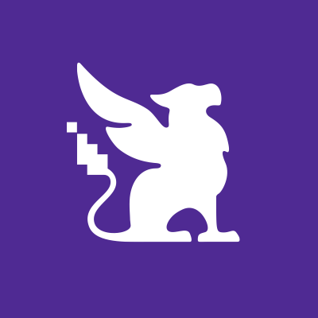
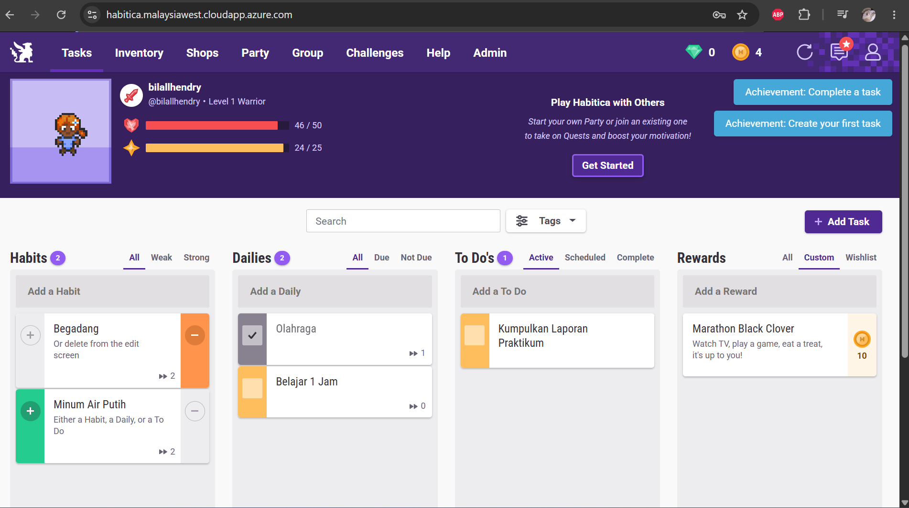
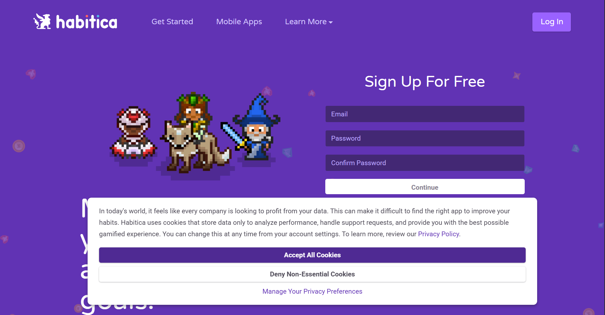
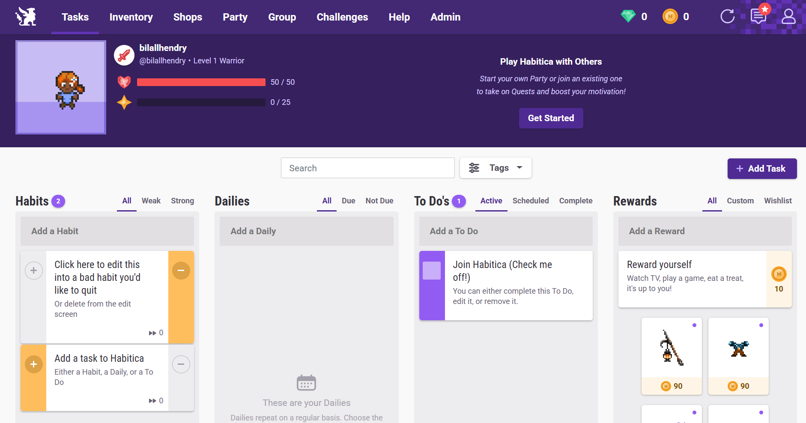
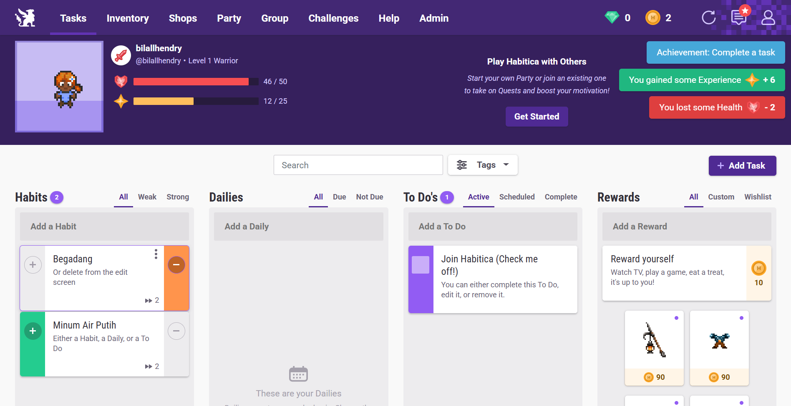
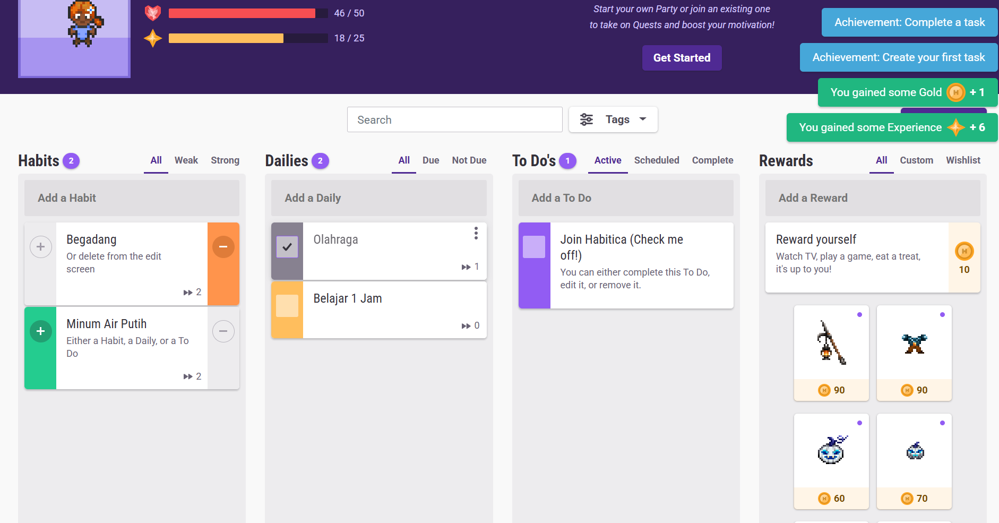
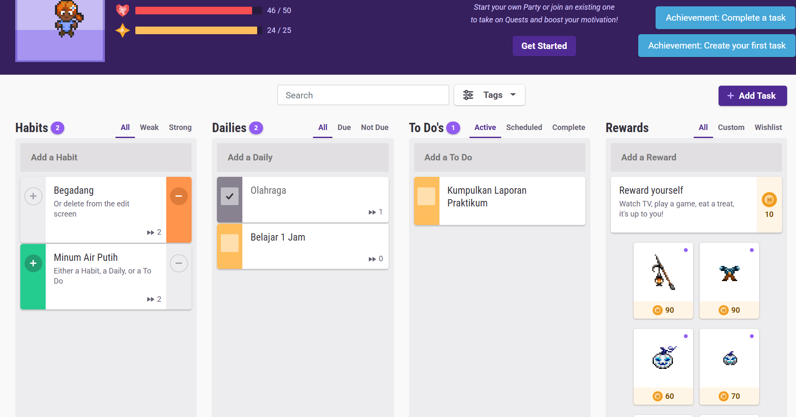
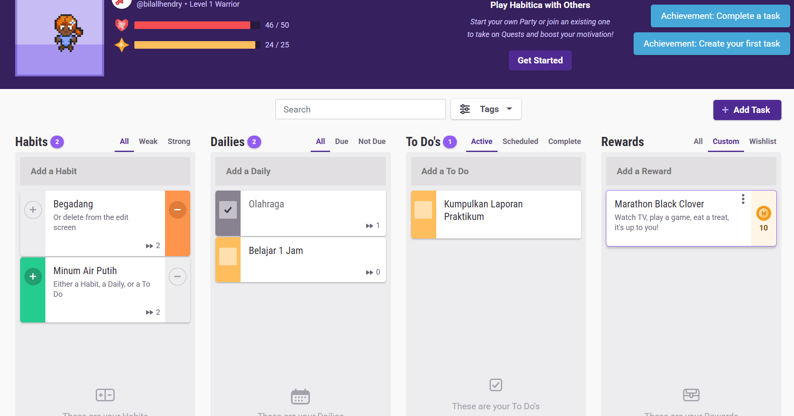
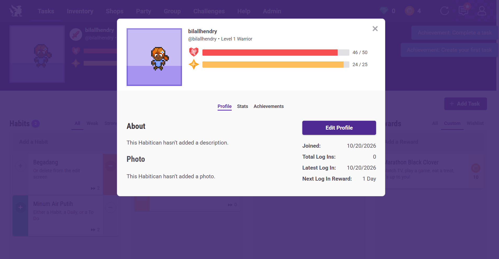
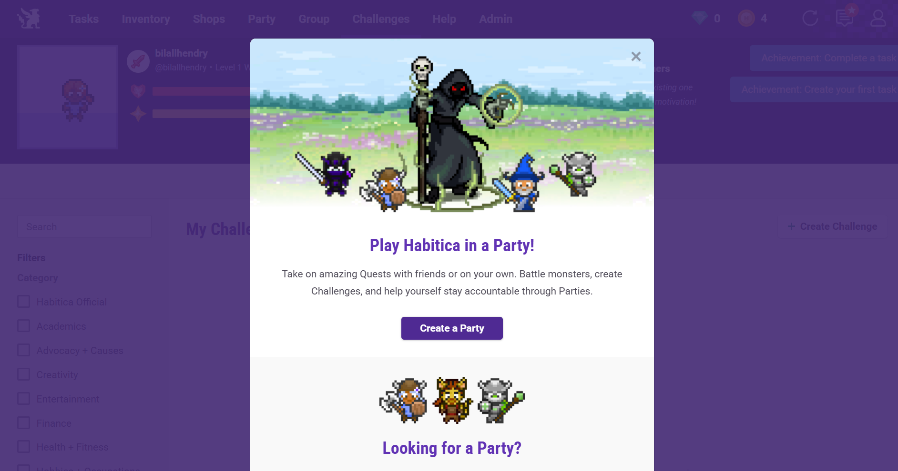

<h1 align="center"></h1>

# Aplikasi Web "Habitica"

**Kelompok 1 Komunikasi Data dan Jaringan**

| No | Nama | NIM |
| --- | --- | --- |
| 1 | Bilall Hendry | M0403241009 |
| 2 | Lian Tora Adi Nugroho | M0403241076 |
| 3 | Ziyad Adiyan Kemal | M0403241085 |
| 4 | Muhammad Ammar Rizky | M0403241088 |
| 5 | Ardian Fadhlurrahman | M0403241113 |

| [Sekilas Tentang](#sekilas-tentang) | [Instalasi](#instalasi) | [Konfigurasi](#konfigurasi) | [Maintenance](#maintenance) | [Otomatisasi](#otomatisasi) | [Cara Pemakaian](#cara-pemakaian) | [Pembahasan](#pembahasan) | [Referensi](#referensi) |
| --- | --- | --- | --- | --- | --- | --- | --- |

# Sekilas Tentang

[`^ kembali ke atas ^`](#)

**Habitica** adalah aplikasi web manajemen tugas dan pembentukan kebiasaan yang dikemas seperti permainan peran (*role-playing game*). Setiap tugas yang kita selesaikan di dunia nyata memberi karakter kita pengalaman (*XP*) dan koin emas, sedangkan tugas yang terlewat mengurangi nyawa (*HP*) karakter. Aplikasi ini juga memiliki fitur sosial seperti *party*, *guild*, dan *challenge*, sehingga pengguna dapat saling menjaga semangat.

Habitica bersifat *Open Source* dan kode sumbernya tersedia di [GitHub](https://github.com/HabitRPG/habitica). Aplikasi ini dibangun dengan `Node.js` dan menyimpan datanya di `MongoDB`. Aplikasi ini mulai dikenal sekitar tahun 2013 dengan nama `HabitRPG`. Karena kodenya terbuka, kita dapat menjalankan Habitica di server sendiri (*self-hosting*) sehingga seluruh data tugas dan karakter tersimpan di infrastruktur kita sendiri.

Pada dokumentasi ini, Habitica dipasang di sebuah **Virtual Machine Microsoft Azure** (*Azure for Students*) dengan **Docker**, dan diakses lewat internet menggunakan **HTTPS**.

Arsitektur sederhananya:

```
Browser --HTTPS--> Caddy (reverse proxy) --> Habitica server --> MongoDB
                   \______________ semuanya berjalan sebagai container Docker ______________/
```

# Instalasi

[`^ kembali ke atas ^`](#)

#### Kebutuhan Sistem :

- Virtual Machine dengan Ubuntu Server 24.04 LTS (64-bit).
- RAM 4 GB (disarankan, ditambah swap 2 GB).
- Ruang disk minimal 30 GB.
- Akses SSH ke server (menggunakan SSH key).
- Port `22` (SSH), `80` (HTTP), dan `443` (HTTPS) terbuka pada firewall / *Network Security Group*.
- Nama domain atau DNS yang mengarah ke IP server. Pada percobaan ini digunakan DNS gratis dari Azure: `habitica.malaysiawest.cloudapp.azure.com`.
- Docker Engine dan Docker Compose plugin (dipasang pada langkah di bawah).

Komponen berikut berjalan sebagai container sehingga tidak perlu dipasang manual:

- **MongoDB 6** (dijalankan sebagai *replica set*, karena dibutuhkan Habitica).
- **Habitica server** (image komunitas `awinterstein/habitica-server`).
- **Caddy 2** (*reverse proxy* sekaligus pembuat sertifikat HTTPS otomatis).

#### Proses Instalasi :

1. Login ke dalam server menggunakan SSH. Ganti `<username>` dengan username VM. Untuk pengguna Windows, perintah ini dapat dijalankan di WSL.

```
$ chmod 600 ~/.ssh/vm-habitica_key.pem
$ ssh -i ~/.ssh/vm-habitica_key.pem <username>@habitica.malaysiawest.cloudapp.azure.com
```

2. Pastikan seluruh paket sistem *up-to-date*.

```
$ sudo apt update && sudo apt upgrade -y
```

3. Tambahkan *swap* 2 GB sebagai cadangan memori, karena Habitica cukup boros RAM.

```
$ sudo fallocate -l 2G /swapfile
$ sudo chmod 600 /swapfile
$ sudo mkswap /swapfile
$ sudo swapon /swapfile
$ echo '/swapfile none swap sw 0 0' | sudo tee -a /etc/fstab
$ free -h
```

4. Pasang Docker menggunakan skrip resmi, lalu beri akses Docker ke user kita.

```
$ curl -fsSL https://get.docker.com | sudo sh
$ sudo usermod -aG docker $USER
```

5. Logout lalu login kembali agar hak akses Docker aktif, kemudian uji Docker.

```
$ exit
$ ssh -i ~/.ssh/vm-habitica_key.pem <username>@habitica.malaysiawest.cloudapp.azure.com
$ docker run hello-world
```

6. Buat direktori kerja untuk Habitica.

```
$ mkdir -p ~/habitica
$ cd ~/habitica
```

7. Buat file `docker-compose.yml`.

```
$ nano docker-compose.yml
```

Isi file dengan konfigurasi berikut :

```yaml
version: "3"

services:
  mongo:
    image: docker.io/mongo:6
    restart: unless-stopped
    command: ["--replSet", "rs", "--bind_ip_all"]
    volumes:
      - mongo-data:/data/db
    networks:
      - habitica
    healthcheck:
      test: >
        mongosh --quiet --eval
        "try { rs.status().ok } catch (e) { rs.initiate({_id:'rs',members:[{_id:0,host:'mongo:27017'}]}).ok }"
      interval: 10s
      timeout: 10s
      retries: 10

  server:
    image: docker.io/awinterstein/habitica-server:latest
    restart: unless-stopped
    depends_on:
      mongo:
        condition: service_healthy
    networks:
      - habitica
    environment:
      - NODE_DB_URI=mongodb://mongo/habitica?replicaSet=rs
      - BASE_URL=https://habitica.malaysiawest.cloudapp.azure.com
      - INVITE_ONLY=false

  caddy:
    image: docker.io/caddy:2
    restart: unless-stopped
    depends_on:
      - server
    ports:
      - "80:80"
      - "443:443"
    volumes:
      - ./Caddyfile:/etc/caddy/Caddyfile
      - caddy-data:/data
      - caddy-config:/config
    networks:
      - habitica

networks:
  habitica:

volumes:
  mongo-data:
  caddy-data:
  caddy-config:
```

8. Buat file `Caddyfile` untuk meneruskan lalu lintas HTTPS ke Habitica.

```
$ nano Caddyfile
```

```
habitica.malaysiawest.cloudapp.azure.com {
    reverse_proxy server:3000
}
```

9. Jalankan seluruh layanan, lalu periksa statusnya.

```
$ docker compose up -d
$ docker compose ps
$ docker compose logs -f
```

Tunggu sekitar 1 sampai 3 menit sampai Caddy berhasil mendapatkan sertifikat HTTPS dan Habitica selesai berjalan. Tekan `Ctrl + C` untuk keluar dari tampilan log.

10. Kunjungi alamat berikut pada browser, lalu buat akun baru.

```
https://habitica.malaysiawest.cloudapp.azure.com
```



11. Setelah akun terbuat, tutup pendaftaran agar tidak sembarang orang dapat membuat akun.

```
$ sed -i 's/INVITE_ONLY=false/INVITE_ONLY=true/' docker-compose.yml
$ docker compose up -d
```

# Konfigurasi

[`^ kembali ke atas ^`](#)

Pengaturan Habitica dilakukan melalui *environment variable* pada service `server` di file `docker-compose.yml`. Setiap perubahan harus diterapkan dengan `docker compose up -d` (perintah `restart` saja tidak membaca ulang perubahan environment).

| Variabel | Fungsi |
| --- | --- |
| `BASE_URL` | Alamat publik aplikasi. Harus diawali `https://` bila memakai Caddy |
| `INVITE_ONLY` | `false` = siapa pun dapat mendaftar, `true` = pendaftaran akun baru ditutup |
| `NODE_DB_URI` | Alamat koneksi ke MongoDB |
| `EMAIL_SERVER_URL`, `EMAIL_SERVER_PORT`, `EMAIL_SERVER_AUTH_USER`, `EMAIL_SERVER_AUTH_PASSWORD` | (Opsional) Pengaturan server SMTP untuk pengiriman email |

Pengaturan jaringan pada Azure :

- Port `22`, `80`, dan `443` dibuka pada *Network Security Group*.
- Alamat IP publik diatur menjadi **Static** dan diberi **DNS name label**, sehingga alamat server tidak berubah.
- Port `3000` (Habitica) dan `27017` (MongoDB) **sengaja tidak dibuka**. Hanya Caddy yang dapat diakses dari internet.

Catatan : pada instance *self-hosted*, fitur reset password dan verifikasi email tidak berfungsi sebagaimana di habitica.com. Karena itu, simpan username dan password di tempat yang aman.

# Maintenance

[`^ kembali ke atas ^`](#)

#### Backup database

```
$ mkdir -p ~/backups
$ cd ~/habitica
$ docker compose exec -T mongo mongodump --db habitica --archive --gzip > ~/backups/habitica-$(date +%F).archive.gz
$ ls -lh ~/backups
```

Backup dapat diperiksa tanpa mengubah data asli :

```
$ gzip -t ~/backups/habitica-TANGGAL.archive.gz && echo "ARSIP UTUH"
```

Untuk mengunduh backup ke komputer lokal (dijalankan di komputer lokal, bukan di server) :

```
$ scp -i ~/.ssh/vm-habitica_key.pem "<username>@habitica.malaysiawest.cloudapp.azure.com:~/backups/*.archive.gz" ~/habitica-backups/
```

#### Restore database

```
$ cd ~/habitica
$ docker compose exec -T mongo mongorestore --archive --gzip --drop < ~/backups/habitica-TANGGAL.archive.gz
```

#### Update aplikasi

Lakukan backup terlebih dahulu, lalu :

```
$ cd ~/habitica
$ docker compose pull
$ docker compose up -d
```

#### Perintah rutin

| Tujuan | Perintah |
| --- | --- |
| Melihat status | `docker compose ps` |
| Melihat log | `docker compose logs -f server` |
| Restart layanan | `docker compose restart` |
| Mematikan layanan (data aman) | `docker compose stop` |
| Menyalakan layanan | `docker compose start` |

Peringatan : perintah `docker compose down -v` akan **menghapus seluruh data** database.

#### Menghemat kredit Azure

Karena memakai kredit *Azure for Students*, VM dimatikan saat tidak digunakan melalui portal Azure (**Stop**, pastikan statusnya *Stopped (deallocated)*). Setelah VM dinyalakan kembali, Habitica berjalan otomatis berkat `restart: unless-stopped`. Setelah seluruh penggunaan selesai, hapus *Resource group* agar tidak ada sisa biaya.

# Otomatisasi

[`^ kembali ke atas ^`](#)

Seluruh langkah instalasi di atas (swap, Docker, file konfigurasi, dan menjalankan layanan) dapat dijalankan sekaligus menggunakan skrip [setup.sh](setup.sh). Jalankan skrip ini pada server (bukan pada komputer lokal), dengan alamat domain sebagai argumen :

```
$ chmod +x setup.sh
$ ./setup.sh habitica.malaysiawest.cloudapp.azure.com
```

Skrip ini melakukan : update sistem, menambah swap 2 GB, memasang Docker, membuat `docker-compose.yml` dan `Caddyfile`, lalu menjalankan seluruh layanan. Isi lengkapnya dapat dilihat pada file [setup.sh](setup.sh).

Backup otomatis setiap hari pukul 03.00 (yang lebih lama dari 14 hari dihapus) dapat dipasang dengan `cron` :

```
$ cat > ~/backup-habitica.sh << 'EOF'
#!/bin/bash
cd ~/habitica
mkdir -p ~/backups
docker compose exec -T mongo mongodump --db habitica --archive --gzip > ~/backups/habitica-$(date +%F).archive.gz
find ~/backups -name "habitica-*.archive.gz" -mtime +14 -delete
EOF
$ chmod +x ~/backup-habitica.sh
$ (crontab -l 2>/dev/null; echo "0 3 * * * ~/backup-habitica.sh") | crontab -
```

# Cara Pemakaian

[`^ kembali ke atas ^`](#)

Habitica memiliki antarmuka yang mudah dipahami. Berikut penjelasannya :

1. Buka alamat Habitica, lalu daftar atau login menggunakan akun yang sudah dibuat.

    

2. Setelah login, kita masuk ke halaman utama (*Tasks*) yang berisi empat kolom : **Habits**, **Dailies**, **To-Dos**, dan **Rewards**.

    

3. Menu **Habits** berisi kebiasaan yang dapat dicatat kapan saja. Kebiasaan baik diberi tanda `+` (memberi XP dan emas), sedangkan kebiasaan buruk diberi tanda `-` (mengurangi HP). Contoh data : *"Minum air putih"* (`+`) dan *"Begadang"* (`-`).

    

4. Menu **Dailies** berisi tugas yang berulang dan direset setiap hari. Tugas yang terlewat akan mengurangi HP karakter. Contoh data : *"Belajar 1 jam"* dan *"Olahraga"*.

    

5. Menu **To-Dos** berisi tugas sekali selesai yang dapat diberi tenggat waktu. Contoh data : *"Kumpulkan laporan praktikum"*.

    

6. Menu **Rewards** berisi hadiah yang dapat "dibeli" dengan emas hasil menyelesaikan tugas, baik hadiah bawaan (perlengkapan karakter) maupun hadiah buatan sendiri, misalnya *"Menonton 1 episode serial"*.

    

7. Pada bagian atas terdapat status karakter : **HP**, **XP**, **Level**, dan **Gold**. Karakter dapat dikustomisasi melalui menu **Inventory**.

    

8. Fitur sosial seperti **Party**, **Guilds**, dan **Challenges** tersedia untuk bermain bersama pengguna lain pada server yang sama.

    

# Pembahasan

[`^ kembali ke atas ^`](#)

**Habitica** menerapkan *gamifikasi* pada manajemen tugas, sehingga pengguna termotivasi menyelesaikan tugas harian karena ada sistem hadiah dan hukuman pada karakter. Berikut kelebihan dari Habitica :

- Konsep permainan membuat pencatatan tugas dan kebiasaan lebih menyenangkan dan memotivasi.
- Bersifat *Open Source* dan dapat dipasang di server sendiri, sehingga data sepenuhnya berada di bawah kendali kita.
- Memiliki fitur sosial (*party*, *guild*, *challenge*) untuk saling menjaga konsistensi.
- Pemasangan dengan Docker membuat seluruh komponen terisolasi dan mudah dipindahkan atau dihapus.

Kekurangan yang ditemui selama pemasangan :

- Tidak ada image Docker resmi untuk produksi. Repositori resmi hanya menyediakan konfigurasi untuk pengembangan, sehingga pada percobaan ini dipakai image komunitas.
- Membutuhkan MongoDB dalam mode *replica set*, bukan MongoDB biasa, sehingga konfigurasinya lebih rumit bagi pemula.
- Cukup boros memori. RAM yang kecil (misalnya 1 GB) hampir pasti tidak cukup, sehingga dibutuhkan VM dengan RAM sekitar 4 GB dan swap.
- Pada instance *self-hosted*, reset password dan verifikasi email tidak berfungsi sebagaimana versi resminya.

Jika dibandingkan dengan aplikasi sejenis seperti **Todoist** dan **Vikunja** :

- **Todoist** lebih sederhana dan cepat dipakai, tetapi bersifat *proprietary* dan tidak dapat dipasang di server sendiri. Habitica unggul pada unsur permainan dan kendali atas data.
- **Vikunja** adalah aplikasi *to-do* open source yang dapat dipasang di server sendiri dan jauh lebih ringan, tetapi tidak memiliki unsur permainan seperti Habitica.
- Pemasangan Habitica lebih rumit dan lebih berat dibanding keduanya, sehingga lebih cocok bagi pengguna yang menginginkan motivasi berbasis permainan dan bersedia mengelola server sendiri.

# Referensi

[`^ kembali ke atas ^`](#)

1. [HabitRPG/habitica](https://github.com/HabitRPG/habitica) - GitHub
2. [Setting Up Habitica for Local Development](https://www.github.com/HabitRPG/habitica/wiki/Setting-Up-Habitica-for-Local-Development) - Habitica Wiki
3. [awinterstein/habitica-server](https://hub.docker.com/r/awinterstein/habitica-server) - Docker Hub
4. [Deploy Habitica](https://railway.com/deploy/habitica) - Railway
5. [Azure for Students FAQ](https://learn.microsoft.com/azure/education-hub/faq) - Microsoft Learn
6. [Install Docker Engine](https://docs.docker.com/engine/install/) - Docker Docs
7. [Caddy Documentation](https://caddyserver.com/docs/) - Caddy
